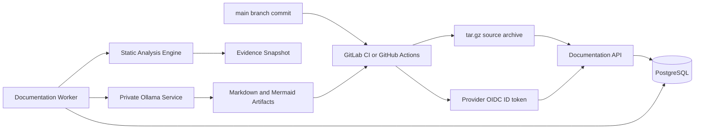

# Architecture

The platform receives source archives from GitLab CI or GitHub Actions over HTTPS with provider-issued CI OIDC tokens. The API validates each token against the configured provider JWKS, authorizes the project/owner/branch, creates an idempotent PostgreSQL job, and returns a job ID immediately. GitHub ingestion is opt-in and uses provider-prefixed repository/owner IDs to isolate all shared storage and scheduling scopes from GitLab.

## Trust Boundaries

- CI OIDC tokens are trusted only after signature, issuer, audience, time, project, owner/group, and branch validation. GitHub additionally restricts signed event types; each provider authenticates only its own API routes.
- Uploaded source code is untrusted data. The worker extracts it into an isolated workspace, rejects unsafe archive entries, and never executes repository scripts.
- Ollama is private to the cluster and receives only normalized, redacted evidence, not full repositories.
- MCP exposes only already-ingested evidence and generated documents subject to authorization.

## Processes

- API: Gin service with GitLab `/api/v1/jobs`, optional GitHub `/api/v1/github/jobs`, health, readiness, and Prometheus-compatible metrics endpoints.
- Worker: leases jobs from PostgreSQL using `FOR UPDATE SKIP LOCKED`, enforces group concurrency, runs analysis and generation, then stores artifacts.
- MCP: official Go MCP SDK using Streamable HTTP transport.
- PostgreSQL: durable scheduling, snapshots, evidence, documents, artifacts, and publication records.

## Evidence Model

Evidence items include ID, category, type, value, source file, optional line range, commit SHA, verification status, confidence, and related components. Documents must separate verified facts, inferred information, and unavailable information.
